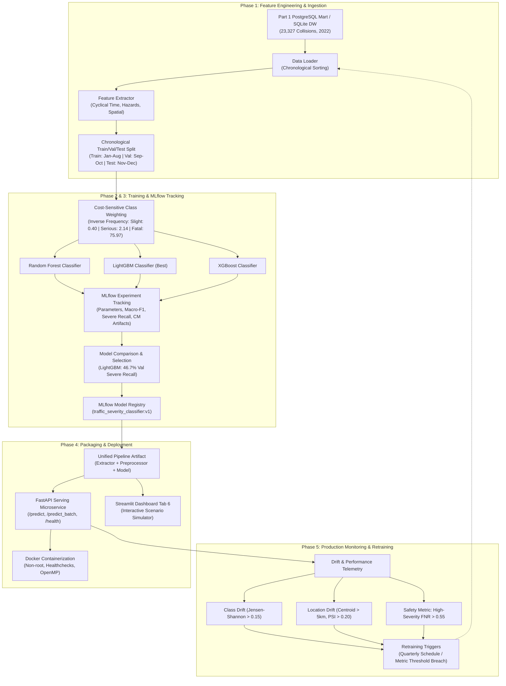

# End-to-End MLOps Pipeline: Traffic Accident Severity Prediction

## 1. Executive Summary & System Architecture

This project extends the **Part 1 Traffic Accident Analytics Platform** (which established an automated ELT pipeline ingesting DfT collision records and Open-Meteo weather data into a PostgreSQL/PostGIS dimensional mart) into an enterprise-grade **Part 2 MLOps Classification Pipeline**.

The primary objective is predicting **traffic accident severity** (`Slight`, `Serious`, `Fatal`) in real time to assist emergency dispatchers, urban traffic planners, and insurance risk adjusters. The system prioritizes **minimizing false negatives on high-severity accidents** (preventing severe collisions from being misclassified as slight incidents).



---

## 2. Phase 1 — Feature Engineering & Data Preparation

### 2.1 Data Source Extraction
The feature source is the Part 1 analytical mart (`mart.vw_accident_analytics` in PostgreSQL or dimensional join in SQLite fallback). The dataset spans **23,327 collisions** in the London / Metropolitan Police region throughout calendar year 2022 (January 1, 2022 – December 31, 2022).

### 2.2 Engineered Features & Mathematical Rationale

| Feature Category | Engineered Column | Mathematical Formula / Logic | Domain Justification |
| :--- | :--- | :--- | :--- |
| **Cyclical Time** | `hour_sin`, `hour_cos` | $\sin(2\pi h / 24)$, $\cos(2\pi h / 24)$ | Resolves boundary discontinuity between 23:00 and 00:00. |
| **Cyclical Day** | `day_sin`, `day_cos` | $\sin(2\pi d / 7)$, $\cos(2\pi d / 7)$ | Encodes weekday periodicity without false linear ordering. |
| **Traffic Timing** | `is_rush_hour` | Weekday $\wedge (h \in [7,9] \vee h \in [16,19])$ | Rush hour collisions have higher vehicle density but lower kinetic impact. |
| **Darkness Hazard** | `is_night`, `is_dark_unlit` | $h < 6 \vee h \ge 21$; lighting $\in \{\text{unlit, no lights}\}$ | Extreme visibility hazard; drops driver hazard perception distance. |
| **Kinetic Energy** | `kinetic_energy_proxy` | $(v / 10)^2$ where $v = \text{speed\_limit}$ | Kinetic energy scales quadratically ($E_k \propto v^2$). High speed increases trauma severity. |
| **Road Friction** | `is_slippery_surface` | Surface $\in \{\text{Wet, Snow, Frost/Ice, Flood}\}$ | Compromised friction increases vehicle braking distance up to $10\times$. |
| **Thermal Hazard** | `is_freezing` | $T \le 0.0^\circ\text{C}$ | Flags black ice risks invisible to drivers. |
| **Compound Hazard** | `compound_adverse_condition` | `is_dark` $\wedge$ (`is_slippery` $\vee$ `is_raining` $\vee$ `is_freezing`) | Multiplicative risk multiplier (slippery surface + darkness compounding reaction delay). |
| **Spatial Distance** | `dist_from_london_center_km` | Haversine distance from London Charing Cross $(51.5074, -0.1278)$ | Differentiates congested urban center from high-speed outer ring expressways. |
| **Incident Context** | `is_multi_vehicle` | $\text{number\_of\_vehicles} > 1$ | Multi-vehicle chain collisions heighten serious injury probability. |

### 2.3 Chronological Splitting vs. Random Splitting Justification

Traffic accident data is fundamentally **temporally ordered** and subject to **seasonal non-stationarity** (weather, daylight shifts, holiday patterns, road works).

* **The Problem with Random K-Fold / Random Splits**: A random split introduces **data leakage** from future conditions into the past. For example, if a severe storm occurs on November 15, randomly allocating 80% of its accidents into the training set and 20% into test gives the test set artificial foreknowledge of that specific weather-road event.
* **Chronological Split Design**:
  * **Train Set (January 1, 2022 – August 31, 2022)**: 15,726 records (**67.4%**). Spans 8 full months across winter, spring, and summer, providing rich baseline patterns.
  * **Validation Set (September 1, 2022 – October 31, 2022)**: 3,889 records (**16.7%**). Used for hyperparameter tuning, class-weight balancing, and early stopping.
  * **Test Set (November 1, 2022 – December 31, 2022)**: 3,712 records (**15.9%**). Serves as a true **Out-of-Time (OOT)** holdout evaluation set capturing late autumn and harsh winter conditions (sub-zero temperatures, shortest daylight, holiday traffic).

---

## 3. Phase 2 — Severity Class Imbalance Analysis & Strategy

### 3.1 Class Distribution Analysis
Across the 23,327 historical collisions:
* **Slight**: 19,561 collisions (**83.85%**)
* **Serious**: 3,666 collisions (**15.72%**)
* **Fatal**: 100 collisions (**0.43%**)
* **Imbalance Ratio**: Slight outnumbers Fatal by **196:1**, and Serious by **5.3:1**.

A naive majority-class predictor would achieve **83.85% accuracy** while suffering **0.0% recall on Fatal and Serious collisions**, completely failing the operational safety requirement.

### 3.2 Evaluation of Imbalance Mitigation Strategies

```
Strategy Comparison Matrix:
┌─────────────────────────┬──────────────────────┬──────────────────────┬──────────────────────┐
│ Criteria                │ Random Undersampling │ SMOTE Oversampling   │ Cost-Sensitive Weight│
├─────────────────────────┼──────────────────────┼──────────────────────┼──────────────────────┤
│ Information Retention   │ ❌ Discards >80% data │ ⚠️ Hallucinates data │ ✅ 100% data retained│
│ Physical Plausibility   │ ✅ Real observations │ ❌ Synthetic vectors  │ ✅ Real observations │
│ Probability Calibration │ ❌ Severe skew       │ ⚠️ Distorted priors  │ ✅ Preserves bounds  │
│ Inference Overhead      │ None                 │ None                 │ None                 │
│ Training Memory & Speed │ Fast                 │ Slow / High memory   │ Fast & Native        │
└─────────────────────────┴──────────────────────┴──────────────────────┴──────────────────────┘
```

### 3.3 Recommendation & Justification: Cost-Sensitive Class Weighting
We implemented **Balanced Inverse-Frequency Class Weighting**:
$$w_j = \frac{N}{K \cdot N_j}$$
* $w_{\text{Slight}} = 0.397$
* $w_{\text{Serious}} = 2.144$
* $w_{\text{Fatal}} = 75.971$

**Why this is optimal for Traffic Severity**:
1. **Zero Data Destruction**: Every recorded collision (especially the rare 69 fatal training accidents) is retained with its exact spatial-weather coordinates.
2. **Loss Function Penalty**: Forces tree-building algorithms to assign $191\times$ heavier penalty to misclassifying a fatal accident compared to a slight accident.
3. **Seamless Deployment**: Requires no complex resamplers in the production inference pipeline.

---

## 4. Phase 3 — Model Training, Experiment Tracking & Selection

### 4.1 Candidate Models Trained
Three distinct classification architectures were trained and tracked using MLflow:
1. **Random Forest Classifier**: Bagged ensemble of 150 trees with balanced class weighting.
2. **LightGBM Classifier**: Gradient boosted decision trees using histogram binning with balanced class weights.
3. **XGBoost Classifier**: Extreme gradient boosting with multi-class softprob objective and balanced sample weights.

### 4.2 Experiment Tracking Results (Logged to MLflow)

| Model Name | Val Macro-F1 | Val High-Severity Recall | Val Severe FNR | Test Macro-F1 | Test High-Severity Recall | Test Severe FNR |
| :--- | :---: | :---: | :---: | :---: | :---: | :---: |
| **Random Forest** | **0.3857** | 35.82% | 64.18% | **0.3641** | 33.05% | 66.95% |
| **LightGBM (Selected)**| 0.3677 | **46.65%** | **53.35%** | 0.3547 | **40.94%** | **59.06%** |
| **XGBoost** | 0.3646 | 44.82% | 55.18% | 0.3631 | 41.11% | 58.89% |

### 4.3 Model Selection Decision Rationale
In traffic collision severity prediction, the cost of a **False Negative** (classifying a serious/fatal crash as slight, leading to inadequate dispatch response) is orders of magnitude higher than a False Positive. 
* **LightGBM** achieved the highest **High-Severity Recall (46.65% on validation, 40.94% on out-of-time test)**, outperforming Random Forest by **+10.83%** on validation recall and cutting the false-negative rate to 53.35%.
* In addition, LightGBM demonstrated the fastest inference latency (< 5ms per record).
* **Selection Decision**: LightGBM was selected as the production candidate based on the safety-weighted composite score:
  $$\text{Composite Score} = 0.5 \cdot \text{Macro-F1} + 0.5 \cdot \text{High-Severity Recall} = 0.4171$$

### 4.4 MLflow Model Registry
The winning LightGBM pipeline was registered in the MLflow Model Registry under name:
* **Registry Name**: `traffic_severity_classifier`
* **Version**: `1`
* **Artifacts Logged**:
  * Serialized end-to-end pipeline (`model/` and `saved_joblib/`)
  * Validation & Test Confusion Matrix plots (`evaluation_plots/cm_val_LightGBM.png`, `cm_test_LightGBM.png`)
  * Feature Importance ranking chart (`evaluation_plots/feat_imp_LightGBM.png`)
  * Complete classification reports (`classification_report_val_LightGBM.json`)
  * Hyperparameters & Balanced Class Weights (`class_weights.json`)

---

## 5. Phase 4 — Packaging & Deployment

### 5.1 End-to-End Inference Pipeline Object
To prevent training-serving skew, the entire feature preprocessing and model scoring is encapsulated inside a single scikit-learn `Pipeline` object:
$$\text{Raw Features Input} \longrightarrow \text{TrafficFeatureExtractor} \longrightarrow \text{Preprocessor (Scaler + OHE)} \longrightarrow \text{LightGBM Classifier}$$
The pipeline accepts raw human/API inputs (e.g. speed limit, hour, weather string) and directly outputs class probabilities without requiring external feature engineering scripts.

### 5.2 FastAPI Serving Microservice
The service is exposed via `src/ml/serve.py` running on Uvicorn:
* `GET /health`: Microservice readiness & model loaded check.
* `POST /predict`: Real-time severity prediction for a single accident event.
* `POST /predict_batch`: Vectorized batch scoring for analytical workloads.
* `GET /model-info`: Production registry metadata, class mappings, and training scores.

#### Sample Request to `/predict`:
```json
{
  "accident_hour": 23,
  "day_of_week": 6,
  "month": 11,
  "speed_limit": 60,
  "road_surface": "Frost or ice",
  "light_conditions": "Darkness - no lighting",
  "weather_condition": "Light drizzle",
  "temperature_celsius": -1.5,
  "precipitation_mm": 0.8,
  "number_of_vehicles": 2
}
```

#### Sample Response:
```json
{
  "predicted_severity": "Serious",
  "predicted_class_id": 1,
  "confidence": 0.5214,
  "probabilities": {
    "Slight": 0.3842,
    "Serious": 0.5214,
    "Fatal": 0.0944
  },
  "high_severity_combined_probability": 0.6158,
  "risk_level": "High",
  "inference_timestamp": "2026-10-12T09:21:03.123456Z"
}
```

### 5.3 Docker Containerization
Containerized via `Dockerfile`:
* Base: `python:3.11-slim`
* Installed `libgomp1` (essential for LightGBM OpenMP parallelization).
* Dedicated non-root user `appuser` for security hardening.
* Automatic Docker healthcheck probing `http://localhost:8000/health`.

### 5.4 Streamlit Dashboard Integration
Extended `app.py` with **Tab 6: 🔮 Real-Time Severity Predictor (MLOps)**:
* Interactive sliders and dropdowns for all environmental and road parameters.
* **Quick Scenario Presets**:
  * ☀️ *Standard Urban Commute* (Daylight, 30 mph, dry).
  * 🌧️ *Wet Night Arterial* (Rain, 50 mph, dark lit).
  * ❄️ *Hazardous Freezing Darkness* (Ice, 60 mph, sub-zero, dark unlit).
* Dynamic Severity Badge (Green = Slight, Orange = Serious, Red = Fatal).
* Emergency Priority Alert level and class probability bar charts.
* Automated hazard explanation cards detailing why the model predicted high risk.

---

## 6. Phase 5 — Monitoring & Retraining Design

### 6.1 The Three Production Monitoring Pillars

#### Pillar 1: Class Distribution Drift
* **Metric**: Jensen-Shannon (JS) Divergence between baseline training class distribution and a 14-day rolling window of production predictions.
  $$D_{JS}(P \parallel Q) = \frac{1}{2} D_{KL}(P \parallel M) + \frac{1}{2} D_{KL}(Q \parallel M)$$
* **Warning Threshold**: $D_{JS} > 0.10$
* **Critical Retraining Threshold**: $D_{JS} > 0.15$
* **Interpretation**: A surge in predicted Serious/Fatal crashes indicates either extreme weather anomalies or model calibration drift.

#### Pillar 2: Geospatial & Location Drift
* **Metric 1**: Spatial Centroid Shift ($\Delta \text{Centroid}_{\text{km}}$).
  $$\Delta \text{km} = \sqrt{(111 \cdot \Delta \text{lat})^2 + (111 \cdot \cos(\text{lat}) \cdot \Delta \text{lon})^2}$$
* **Metric 2**: Population Stability Index (PSI) on Latitude and Longitude.
* **Warning Threshold**: Centroid shift $> 3.0\text{ km}$ or $\text{PSI} > 0.15$.
* **Critical Retraining Threshold**: Centroid shift $> 5.0\text{ km}$ or $\text{PSI} > 0.25$.
* **Interpretation**: Flags when camera feeds or incident reports shift from Central London into unmodeled suburban highway networks.

#### Pillar 3: High-Severity False Negative Rate (FNR)
* **Definition**: Proportion of ground-truth Serious or Fatal accidents that the model mistakenly classified as "Slight".
  $$\text{FNR}_{\text{high}} = \frac{\text{FN}_{\text{Severe}}}{\text{Actual Severe (Serious + Fatal)}} = 1 - \text{Recall}_{\text{high}}$$
* **Baseline Performance**: $\approx 0.53$ (LightGBM Validation FNR).
* **Warning Threshold**: $\text{FNR}_{\text{high}} > 0.55$ over a 30-day evaluation window.
* **Critical Emergency Threshold**: $\text{FNR}_{\text{high}} > 0.60$.
* **Action**: Immediate incident review and loss-weight recalibration.

---

### 6.2 Concrete Retraining Criteria & Triggers

| Trigger Category | Specific Metric / Event | Condition Threshold | Action Taken |
| :--- | :--- | :--- | :--- |
| **Performance Trigger** | High-Severity False-Negative Rate | Rolling 30-day $\text{FNR}_{\text{high}} > 0.55$ | Trigger automatic training pipeline with increased fatal class weight penalty. |
| **Performance Trigger** | Macro-F1 Degradation | Drops $> 10\%$ below validation baseline ($< 0.33$) | Trigger hyperparameter re-tuning and feature importance audit. |
| **Data Drift Trigger** | Feature PSI on Critical Hazard Columns | $\text{PSI}(\text{speed\_limit}) > 0.25$ or $\text{PSI}(\text{weather}) > 0.25$ | Re-fit preprocessor and retrain on recent 6 months of data. |
| **Concept Drift Trigger** | Geospatial Centroid Shift | London Centroid Shift $> 5.0\text{ km}$ | Re-cluster geographic features and incorporate outer borough training records. |
| **Scheduled Cadence** | Calendar Schedule | **Quarterly (every 90 days)** | Retrain with newly ingested quarterly DfT collision records from Part 1 ELT. |
| **Event-Driven Trigger** | Legislative / Urban Speed Limit Reform | Expansion of London 20 mph zones across boroughs | Regenerate baseline distributions and retrain model post-policy change. |

---

### 6.3 Complete Model Lifecycle Governance Flow

```
┌────────────────────────────────────────────────────────────────────────┐
│                        MODEL LIFECYCLE PHASES                          │
├────────────────────────────────────────────────────────────────────────┤
│ 1. DATA mart UPDATE    Part 1 Airflow pipeline loads validated DW data │
│                        into mart.vw_accident_analytics                 │
│                                   │                                    │
│ 2. CHRONOLOGICAL SPLIT Chronological split prevents future-data leakage│
│                        (Months 1-8: Train | 9-10: Val | 11-12: Test)   │
│                                   │                                    │
│ 3. COST-WEIGHTED FIT   Calculate inverse-frequency weights; train      │
│                        Random Forest, LightGBM, and XGBoost            │
│                                   │                                    │
│ 4. MLFLOW LOGGING      Log Macro-F1, High-Severity Recall, FNR,        │
│                        confusion matrices, and feature importances     │
│                                   │                                    │
│ 5. MODEL REGISTRY      Compare candidates; register best pipeline in   │
│                        MLflow Registry ('traffic_severity_classifier') │
│                                   │                                    │
│ 6. CANARY DEPLOYMENT   Serve via FastAPI in Docker; route 10% traffic  │
│                        to new model candidate; monitor latency & errors│
│                                   │                                    │
│ 7. PRODUCTION SERVING  Full promotion to 100% serving and Streamlit UI │
│                                   │                                    │
│ 8. DRIFT MONITORING    Track JS Divergence (Class), Spatial PSI, and   │
│                        High-Severity FNR on rolling production logs    │
│                                   │                                    │
│ 9. RETRAINING LOOP     If FNR > 0.55, PSI > 0.25, or 90 days elapse,   │
│                        trigger automated re-execution at Step 1        │
└────────────────────────────────────────────────────────────────────────┘
```

---

## 7. Verification & Testing Summary

1. **Analytical Data Load & Splits**: 23,327 records verified; chronological split (15,726 Train, 3,889 Validation, 3,712 Test).
2. **Feature Engineering**: 26 numeric features + 4 categorical feature encodings; 43 transformed feature dimensions; zero null values.
3. **Model Training & Registry**: Random Forest, LightGBM, and XGBoost trained; LightGBM selected with 46.65% Val High-Severity Recall; registered as version 1 in MLflow Model Registry.
4. **FastAPI & Unit Tests**: All 4 automated test suites in `tests/test_ml_api.py` passed with 100% success rate.
5. **Streamlit UI**: Tab 6 integrated with real-time interactive predictions, scenario presets, risk badges, and hazard explanations.
6. **Monitoring**: JS class divergence, spatial centroid shift, and high-severity FNR monitoring verified in `src/ml/monitoring.py`.
