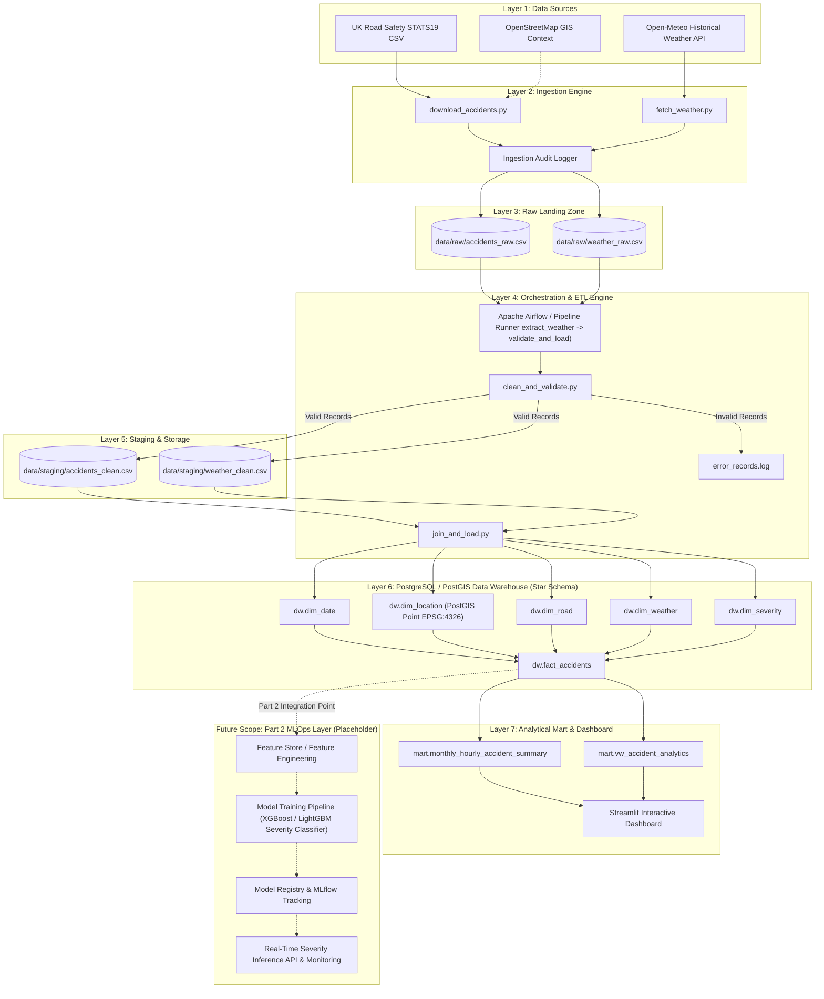

# System Architecture Diagram — Traffic Accident Severity Analytics

## High-Level End-to-End Pipeline Architecture

---

## 7-Layer Architectural Summary

1. **Source Layer**: Official UK DfT STATS19 Road Collision Open Data CSVs and Open-Meteo REST API.
2. **Ingestion Layer**: Modular Python ingestion scripts logging record counts, extraction timestamps, and SHA256 integrity hashes.
3. **Raw Landing Zone**: Local file storage preserving raw unmutated data (`data/raw/`).
4. **Orchestration & ETL Layer**: Apache Airflow DAG (`dags/accident_pipeline_dag.py`) executing a 3-task dependency graph: `extract_accidents` -> `extract_weather` -> `validate_and_load`. Spatial validation rejects out-of-bound coordinates to `data/logs/error_records.log`.
5. **Staging Layer**: Validated CSV datasets with normalized schema types (`data/staging/`).
6. **Storage Layer (Star Schema DW)**: PostgreSQL / PostGIS database hosting dimension tables (`dim_date`, `dim_location`, `dim_road`, `dim_weather`, `dim_severity`) and centralized `fact_accidents` table.
7. **Analytics & Presentation Layer**: Pre-aggregated `mart.monthly_hourly_accident_summary` table and `mart.vw_accident_analytics` view consumed by a 5-tab Streamlit dashboard (`app.py`).
8. **Part 2 MLOps Layer Placeholder**: Decoupled schema interface ready to feed historical features (`fact_accidents` + `dim_weather` + `dim_road`) into Part 2 model training pipelines.
